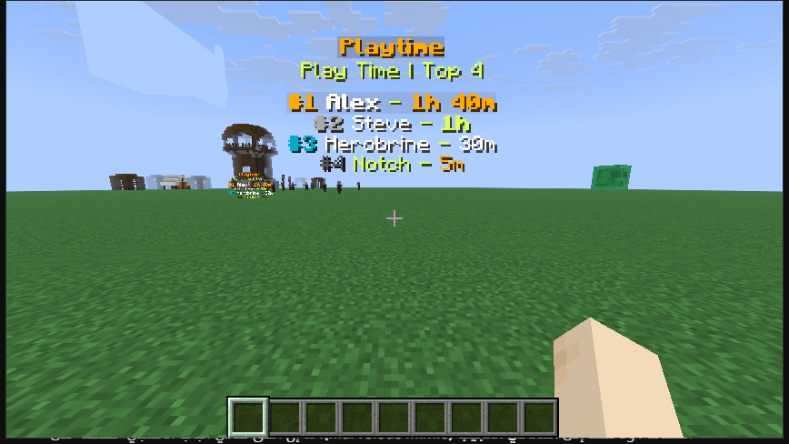

# Leaderboard Hologram

Server-side leaderboard holograms for Minecraft, built from vanilla display entities. Players see floating top-player boards with a vanilla client; only the server installs the mod.

The mod tracks 44 statistic presets (play time, deaths, kills, mining, gathering, crafting, trades, movement and more), supports aggregate statistics, four themes, persistent named boards and a five-minute refresh.



## Quick start

Put the jar in your server `mods` folder, start the server, then run:

```mcfunction
/leaderboard create quick play_time
```

That gives you a board with the top 10 players. Use `/leaderboard settheme <name> gold` to change the look, or `/leaderboard presets` to see the other stats.

## Supported targets

### Fabric

| Minecraft | Source in this repository |
| --- | --- |
| 1.21.11 | `fabric/` |
| 1.21.1 | `fabric/versions/1.3.0-mc1.21.1/` |
| 1.21.4 | `fabric/versions/1.3.0-mc1.21.4/` |
| 1.20.1 | `fabric/versions/1.3.0-mc1.20.1/` |

Published Fabric jars also cover 1.21.2–1.21.10 and 26.1/26.1.1. Those targets share the recovered class sets but have not all been rebuilt from source in this tree.

### NeoForge

| Minecraft | NeoForge | Source | Dedicated-server test |
| --- | --- | --- | --- |
| 1.20.1 | 47.1.106 | `neoforge/1.20.1/` | tested |
| 1.21.1 | 21.1.60 | `neoforge/1.21.1/` | tested |
| 1.21.10 | 21.10.64 | `neoforge/1.21.10/` | tested |
| 1.21.11 | 21.11.42 | `neoforge/1.21.11/` | tested |
| 26.1.2 | 26.1.2.126 | `neoforge/26.1.2/` | tested |
| 26.2 | 26.2.0.93 | `neoforge/26.2/` | tested |
| 26.3 | 26.3.0.102 | `neoforge/26.3/` | tested |

NeoForge 26.1.0 and 26.1.1 only have beta loader builds upstream; the stable 26.1 target is 26.1.2.

## Requirements

- Minecraft Java Edition with the exact loader and version matching the jar.
- Fabric Loader and Fabric API for Fabric builds.
- NeoForge only for NeoForge builds. Do not install Fabric API with a NeoForge jar.
- Java 21 for Minecraft 1.20.1–1.21.11. Java 25 for 26.x.
- Server-side installation only.

## Install

1. Install the matching loader on the server.
2. Put the mod jar and its required dependency in `mods/`.
3. Start the server.

Boards are saved in `config/leaderboard_holograms.json` on both loaders.

## Commands

All commands require permission level 2 (operator) or the server console. Creation and player-relative movement require a player.

```mcfunction
/leaderboard create quick play_time
/leaderboard create preset miners diamonds_collected 10
/leaderboard create path totems "minecraft:used/minecraft:totem_of_undying" 5
/leaderboard settheme miners gold
/leaderboard setstat preset miners mob_kills
/leaderboard refresh
/leaderboard reload
```

Run `/leaderboard presets`, `/leaderboard themes`, `/leaderboard list` and `/leaderboard info <name>` in game for the full interface.

## Build

The repository uses one Gradle wrapper (9.8.2). Build a target with `-p`:

```bash
./gradlew -p fabric build
./gradlew -p neoforge/1.21.11 build
./gradlew -p neoforge/26.1.2 build
```

On Windows use `gradlew.bat`. Fabric 1.20.1–1.21.11 targets compile with Java 21; NeoForge 26.x targets compile with Java 25.

## Layout

```
fabric/                  current Fabric 1.21.11 source
fabric/versions/         recovered Fabric source branches
neoforge/<mc>/           independent NeoForge projects
showcase/                in-game screenshots used on the store pages
```

Every project keeps the mod id `leaderboard` and the same command tree so worlds and configs stay compatible across loaders.

## Source provenance

The original source tree was lost. This tree was reconstructed from the published MIT-licensed jars: bytecode was remapped to readable mappings where needed and decompiled, then rebuilt and tested per target. Comments and local names that were not present in debug metadata cannot be recovered. Matching signatures alone is not treated as proof; behavioral and dedicated-server tests are used for acceptance.

## License

MIT. See [LICENSE](LICENSE).

Author: Kador (v_eno).
